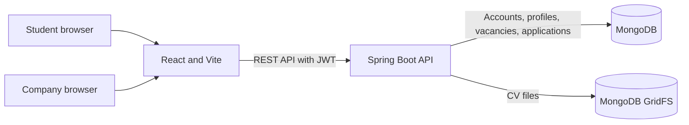

# CareerIS

**CareerIS — Student Skills and Internship Matching System** connects students seeking internships with companies recruiting interns. Students build a profile, upload a CV, browse opportunities, and apply. Companies publish vacancies, review applications, and schedule interviews.

> CareerIS is a rule-based internship platform. It does not use AI matching.

## Features

### Students

- Register and sign in with a student account
- Add education, qualifications, skills, and a short profile summary
- Upload or replace a CV in PDF, DOC, or DOCX format (maximum 5 MB)
- Browse, search, and filter open internship vacancies
- Apply to a vacancy with an optional note
- Track application status and view interview date, time, location or meeting link, and notes

### Companies

- Register and sign in with a company account
- Create, edit, close, and reopen internship vacancies
- Review applications and view the applicant's profile and CV
- Mark applications Under review, Interview, or Rejected
- Schedule or update interview details for invited students

## Technology

| Area | Technology |
| --- | --- |
| Frontend | React 19, JavaScript, Vite, CSS |
| Backend | Java 17, Spring Boot 3.4, Maven |
| Database and CV storage | MongoDB, Spring Data MongoDB, GridFS |
| API and security | REST/JSON, Spring Security, JWT bearer tokens |

## Architecture



The API applies student and company role checks. Company vacancy and application operations are restricted to records owned by the signed-in company. CV access is authenticated and limited to the student who uploaded it or a company reviewing that student's application.

## Repository layout

```text
frontend/   React and Vite application
backend/    Spring Boot REST API
```

## Run locally

### Prerequisites

- Node.js and npm
- Java 17 or newer
- Maven
- MongoDB running locally, or a MongoDB connection string

### 1. Start MongoDB

Start your local MongoDB service and make sure it accepts connections at `mongodb://localhost:27017`. Or use a different MongoDB connection string by setting `MONGODB_URI` before starting the backend.

### 2. Start the backend

In Terminal 1, from the repository root:

```bash
cd backend
export MONGODB_URI="mongodb://localhost:27017/careeris"
export JWT_SECRET="$(openssl rand -base64 32)"
mvn spring-boot:run
```

The API runs at `http://localhost:8080`. Keep this terminal open. The JWT secret should stay the same while you use the app; changing it invalidates existing sign-in sessions.

### 3. Start the frontend

In Terminal 2, from the repository root:

```bash
cd frontend
npm install
npm run dev
```

Open the local URL printed by Vite, usually `http://localhost:5173`. Vite forwards `/api` requests to the backend at port `8080`.

## Demo workflow

1. Create a student account and a company account using different email addresses.
2. Sign in as the company and publish an internship with a future deadline.
3. Sign in as the student, complete the profile, upload a CV, and apply.
4. Sign in as the company, review the application and profile, then choose **Invite to interview**.
5. Enter a future date, time, and meeting location or link, then save the interview details.
6. Sign in as the student and refresh **My applications** to see the interview schedule.

## API overview

Protected routes require `Authorization: Bearer <token>`. `/api/student/**` routes require a student account, `/api/company/**` routes require a company account, and `/api/vacancies/**` routes are available to signed-in students and companies. Registration, login, and the health check are public.

### Authentication

| Method | Endpoint | Purpose |
| --- | --- | --- |
| `POST` | `/api/auth/register` | Register a student or company |
| `POST` | `/api/auth/login` | Sign in and receive a JWT |
| `GET` | `/api/health` | Check API health |

### Student routes

| Method | Endpoint | Purpose |
| --- | --- | --- |
| `GET` | `/api/vacancies` | Browse open vacancies |
| `GET` | `/api/vacancies/{id}` | View an open vacancy |
| `GET` / `PUT` | `/api/student/profile` | Read or update the signed-in student's profile |
| `POST` | `/api/student/profile/cv` | Upload or replace a CV (`multipart/form-data`, field `file`) |
| `GET` | `/api/student/profile/cv` | Download the student's own CV |
| `GET` | `/api/student/applications` | View the student's applications and statuses |
| `POST` | `/api/student/applications` | Apply with `vacancyId` and optional `coverLetter` |

### Company routes

| Method | Endpoint | Purpose |
| --- | --- | --- |
| `GET` / `POST` | `/api/company/vacancies` | List or publish company vacancies |
| `PUT` | `/api/company/vacancies/{id}` | Edit an owned vacancy |
| `PATCH` | `/api/company/vacancies/{id}/status` | Open or close a vacancy |
| `GET` | `/api/company/applications` | Review applications |
| `PATCH` | `/api/company/applications/{id}/status` | Update application status |
| `PATCH` | `/api/company/applications/{id}/interview` | Save interview date, time, location, and notes |
| `GET` | `/api/company/applications/{id}/student-profile` | View an applicant's profile |
| `GET` | `/api/company/applications/{id}/cv` | Download an applicant's CV |

## Build commands

Build the frontend:

```bash
cd frontend
npm run build
```

Compile the backend:

```bash
cd backend
mvn -DskipTests compile
```

## Deploy the full website

CareerIS can run as one Render web service: the container builds the React frontend and Spring Boot backend, and Spring Boot serves both from the same URL. MongoDB Atlas stores accounts, vacancies, applications, and uploaded CVs in GridFS.

### Prepare MongoDB Atlas

1. Create an Atlas project and a free cluster.
2. Create a database user with a strong password and read/write access to the CareerIS database.
3. Copy the Atlas driver connection string and set the database name to `careeris`, for example `mongodb+srv://<user>:<password>@<cluster>/careeris?retryWrites=true&w=majority`. URL-encode special characters in the password.

### Create the Render service

1. Push this repository to GitHub and sign in to Render.
2. In Render, choose **New → Blueprint**, connect the `CareerIS` GitHub repository, and select the `main` branch.
3. Render reads the root `render.yaml` and creates the `careeris` service from the Dockerfile. When prompted, provide the Atlas connection string as `MONGODB_URI`. Render generates `JWT_SECRET` for the service.
4. In the Render service details, open **Connect → Outbound** and add the listed CIDR ranges to the Atlas IP access list. Use these ranges to restrict database connections to Render's published ranges instead of allowing connections from every IP.
5. Redeploy if needed, then open the service URL. The website and API share that URL; check `<service-url>/api/health` for the API health response.

The free Render web service spins down after 15 minutes without traffic, so its first request after idle may take about a minute to wake up. The service filesystem is temporary, but CareerIS stores CVs in MongoDB GridFS rather than on that filesystem.

## Security and privacy

- Passwords are hashed before storage.
- Keep `JWT_SECRET` and database credentials out of GitHub.
- Never commit real CVs, passwords, or other private user data.
- Uploaded CVs are stored in MongoDB GridFS, not in the public frontend files.
